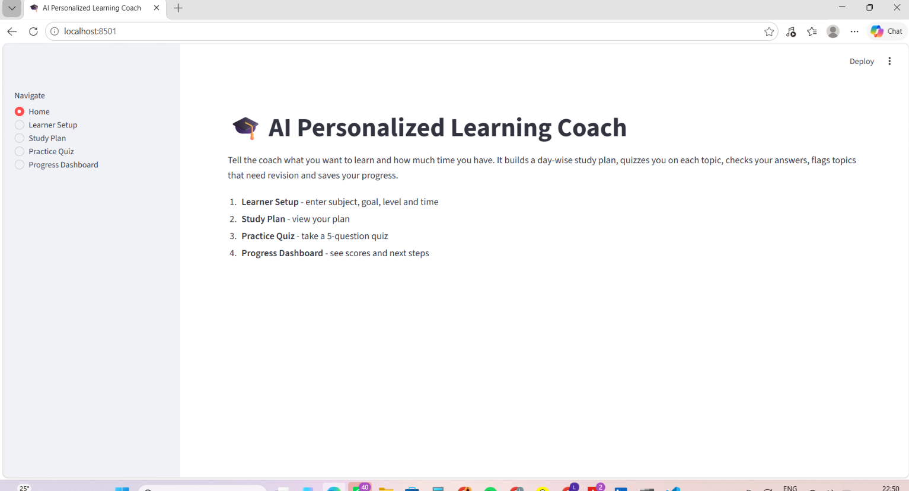
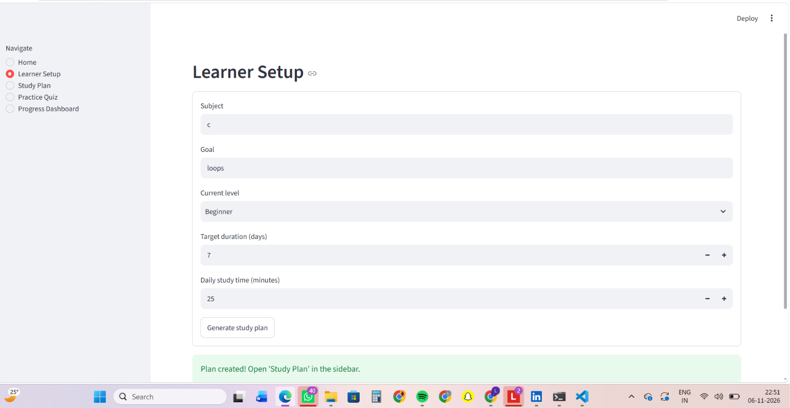
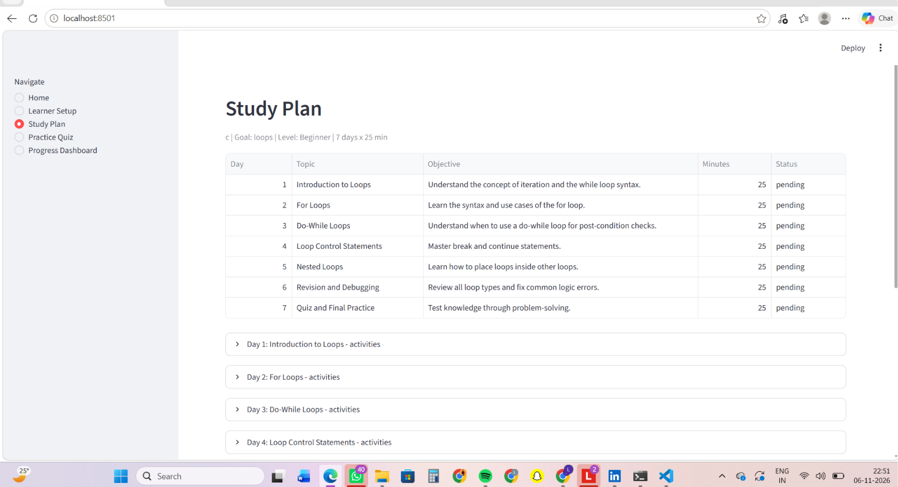
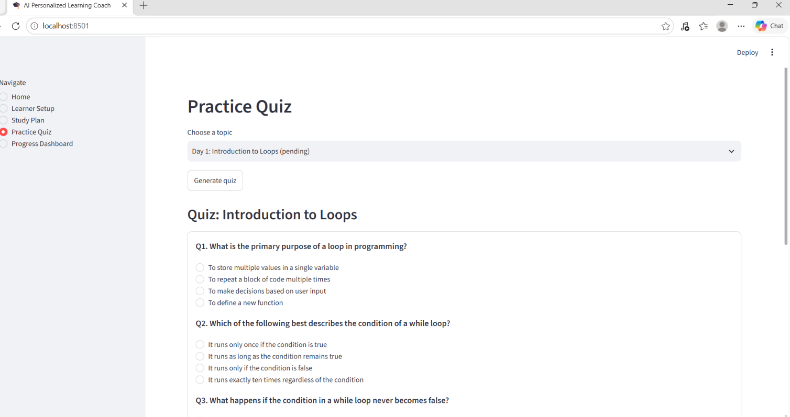
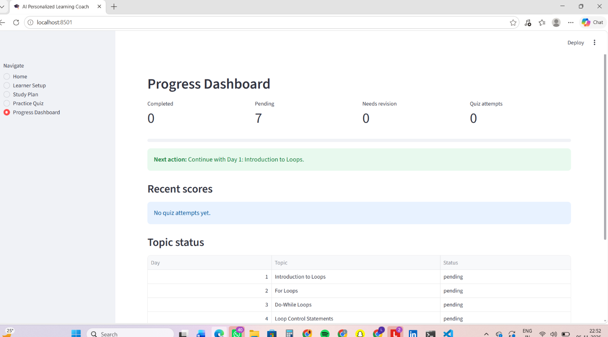

# 🎓 AI Personalized Learning Coach

An AI-powered learning assistant built using Python, Streamlit, Google Gemini API, and SQLite. It creates personalized, day-wise study plans, generates topic-based quizzes, evaluates answers, identifies weak topics, and tracks learning progress.

## ✨ Features

- **Learner Setup:** Enter subject, learning goal, current level, study duration, and daily study time.
- **AI Study Plan:** Generate a personalized day-wise study plan using Google Gemini.
- **Study Plan Validation:** Validate the AI-generated plan before saving it.
- **Practice Quiz:** Generate 5 multiple-choice questions for each topic.
- **Automatic Scoring:** Evaluate answers in Python using the correct answer key.
- **Learning Feedback:** Get explanations, identify weak topics, and receive next-step recommendations.
- **Progress Dashboard:** Track completed and pending topics, quiz scores, and score trends.
- **SQLite Database:** Save learner profiles, study plans, topics, and quiz attempts.
- **Error Handling:** Handle invalid AI responses, API failures, empty inputs, and database errors.

## 📸 Project Screenshots

### 1. Home Page


### 2. Learner Setup


### 3. Study Plan


### 4. Practice Quiz


### 5. Progress Dashboard


## 🛠️ Tech Stack

- Python
- Streamlit
- Google Gemini API
- SQLite
- Pandas
- python-dotenv
- Git and GitHub

## 📂 Project Structure

```text
AI-Personalized-Learning-Coach/
│
├── app.py
├── ai_service.py
├── learning_plan.py
├── quiz_manager.py
├── database.py
├── test_offline.py
├── requirements.txt
├── .env.example
├── .gitignore
├── README.md
│
├── sample_data/
│   └── example_learning_plan.json
│
└── screenshots/
    ├── home.png
    ├── learner-setup.png
    ├── study-plan.png
    ├── practice-quiz.png
    └── dashboard.png
```

## ⚙️ Installation and Setup

### 1. Clone the repository

```bash
git clone https://github.com/likki-hi/AI-Personalized-Learning-Coach.git
cd AI-Personalized-Learning-Coach
```

### 2. Create a virtual environment

```bash
python -m venv venv
```

### 3. Activate the virtual environment

**Windows:**
```powershell
venv\Scripts\activate
```

**Mac/Linux:**
```bash
source venv/bin/activate
```

### 4. Install dependencies

```bash
pip install -r requirements.txt
```

### 5. Configure the Gemini API key

Create a `.env` file by copying `.env.example`.

**Windows PowerShell:**
```powershell
Copy-Item .env.example .env
```

**Mac/Linux:**
```bash
cp .env.example .env
```

Open `.env` and add your Gemini API key and model configuration:

```env
GEMINI_API_KEY=your_gemini_api_key
GEMINI_MODEL=gemini-3.1-flash-lite
```

Never upload your actual `.env` file or API key to GitHub.

### 6. Run the application

```bash
python -m streamlit run app.py
```

## 🗄️ Database Design

The application uses SQLite to store learning information.

```text
learner_profile
      |
     plans
      |
    topics
      |
 quiz_attempts
```

Topic status values:

- `pending`
- `completed`
- `needs_revision`

## 📊 Quiz Recommendation Rules

| Quiz Score | Recommendation |
|---|---|
| Below 60% | Needs revision |
| 60%–80% | Completed with light practice |
| Above 80% | Move forward to the next topic |

## 🧪 Testing

Run the offline tests using:

```bash
python test_offline.py
```

The tests cover validation, scoring, recommendations, database persistence, repeated attempts, and missing API key handling.

The application UI was also tested manually.

## ⚠️ Limitations

- A five-question quiz is only a basic indicator of topic understanding.
- AI-generated questions and answer keys may occasionally contain errors.
- The application does not currently support individual user accounts.
- An internet connection and a valid Gemini API key are required for AI features.

## 👩‍💻 Author

**Likitha Kalal**

B.Tech – Computer Science and Engineering

GitHub: [likki-hi](https://github.com/likki-hi)